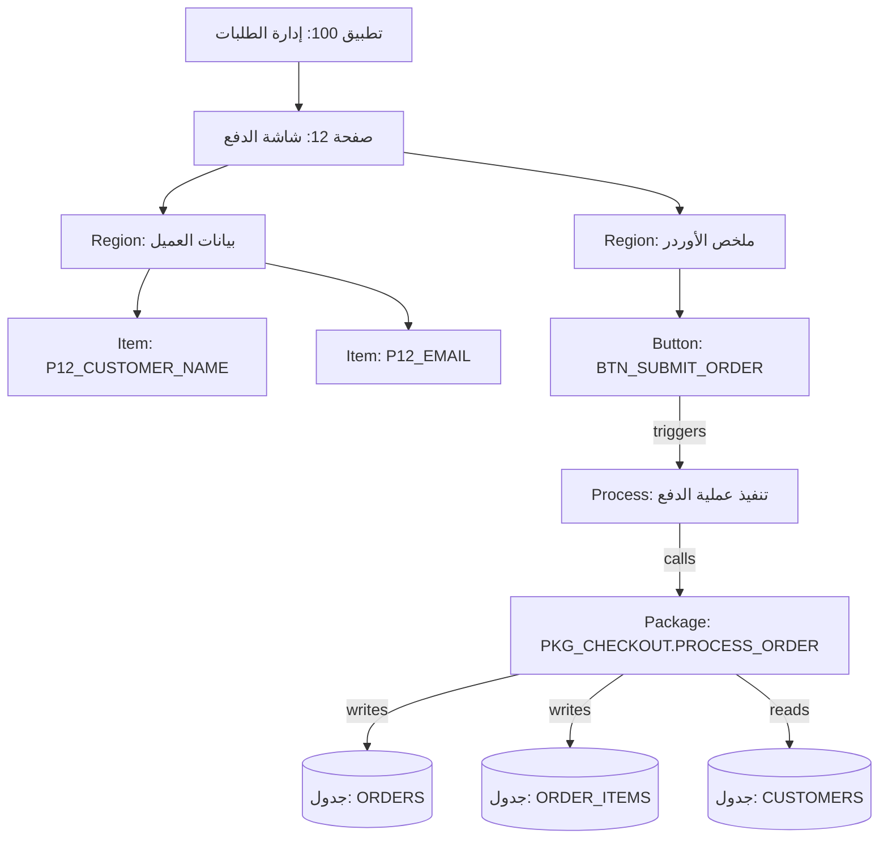

> 🇬🇧 **English Version:** Read the original article in English [here](https://ash2osh.hashnode.dev/graphing-the-skyscraper-building-an-ast-knowledge-graph-for-apex).

# رسم ناطحة السحاب: بناء الـ AST Knowledge Graph لأوراكل أبيكس 🗺️🏗️

*الجزء الثالث من سلسلة "مطور APEX المدعوم بالذكاء الاصطناعي".*

* * *

## ⚡ الخلاصة في كلمتين (TL;DR)

> إنك تسيب AI Coding Agent في فولدر فيه 50 ملف وتقوله "حل لي المشكلة المعقدة دي"، ده بالظبط زي ما تنزل سائح في وسط طوكيو وتديله دليل مطبوع فيه أسامي الشوارع مترتبة أبجدياً بس من غير خريطة!
> 
> بتحليل ملفات APEX وتحويلها لـ **شجرة نحو تجريدية (AST)** ورفعها على **Knowledge Graph** معماري، بتدي للـ Agent بتاعك ماكيت هندسي ثلاثي الأبعاد للمشروع كله.
> 
> بدل ما يقعد يخمن العلاقات بالبحث النصي العشوائي، الـ Agent بيقدر يتتبع المسار الدقيق بالمللي: من دوسة الزرار في صفحة 12 لحد جداول الداتابيز اللي بتتقري وتتعدل في الخلفية!

* * *

## 🗺️ خريطة الـ GPS ضد دليل أسامي الشوارع المطبوع

تخيل إنك سايق رايح مستشفى في مدينة أول مرة في حياتك تزورها:

*   **طريقة الدليل الأبجدي**: تطلع كتاب تليفونات فيه 5000 اسم شارع مترتبين من الألف للياء. أنت عارف إن المستشفى في "شارع النخيل"، بس مضطر تقلب في كل الشوارع عشان تخمن أنهي شارع بيوصل له، وأنهي كوبري بيعدي النيل، والشوارع دي اتجاه واحد ولا اتنين!
*   **طريقة خريطة الـ GPS**: تبص في شاشة الملاحة. بتشوف فوراً مكانك الحالي، والملفات اللي هتدخلها بالترتيب، والكباري، ودبوس المستشفى منور بالأحمر على الخريطة في ثواني!

لما مساعدي الذكاء الاصطناعي يعتمدوا بس على البحث النصي العادي (`grep`) أو الـ Vector Embeddings العامة (RAG)، بيكونوا زي السائح التايه في شوارع طوكيو بالظبط.

لو سألته: *"لما اليوزر يدوس على زرار 'اعتماد استرجاع الفلوس' (Approve Refund)، أنهي جداول بتتعدل؟"*، البحث النصي هيدور على كلمة `"REFUND"`. هيرجع لك 85 نتيجة ملهاش أي علاقة بالموضوع من ملفات قديمة وكومنتات ولوجات—وهيحرق رصيدك في التوكنز ويهبد علاقات مش موجودة!

عشان نخلي الـ AI يشتغل بدقة جراحية في مشروعات Oracle APEX، محتاجين **خريطة معمارية صريحة (Explicit Structural Topology)**.

* * *

## 🌳 يعني إيه شجرة نحو تجريدية (Abstract Syntax Tree - AST)؟

قبل ما نبني الجراف، لازم نفهم الكمبيوتر بيقرا الكود إزاي.

أنت كإنسان لما بتبص على الكود بتشوف كلام وجمل. لكن الكومبيلر والمحلل (Parser) لما بيقرأ الكود، بيفككه لشجرة هرمية اسمها **Abstract Syntax Tree (AST)**.

تخيل تطبيق Oracle APEX كأنه شجرة ضخمة متفرعة:

*   **جذع الشجرة (Trunk)**: التطبيق نفسه (App ID، اسمه، نظام الأمان).
*   **الفروع الكبيرة**: الصفحات (صفحة 1، صفحة 12، صفحة 40).
*   **الفروع الصغيرة**: المناطق (Regions) جوه كل صفحة (Grids، Forms، شاشات ثابتة).
*   **الأوراق الخضراء**: العناصر المنفردة (`P12_EMAIL`)، والزراير (`BTN_SUBMIT`)، والـ Processes.
*   **فروع اللبلاب المتسلقة**: الـ Dynamic Actions ونداءات الـ PL/SQL Packages اللي بتربط عناصر الشاشة بجداول الداتابيز الحقيقية.



شايف الجمال؟ ده مش مجرد لستة ملفات مرصوصة—دي **شبكة علاقات واعتماديات موجهة (Directed Dependency Graph)**!

أول ما التطبيق يتحول لـ Nodes وأسهم (Edges)، الـ AI مستحيل يخمن إيه اللي بيحصل لما `BTN_SUBMIT_ORDER` يتداس عليه—هيمشي ورا السهم مباشرة لـ `PKG_CHECKOUT` ويعرف في ثانية إن جدولي `ORDERS` و `ORDER_ITEMS` هما اللي بيتعدلوا!

* * *

## ⚙️ تشريح الـ APEX Knowledge Graph من جوه

الجراف ده متكون من إيه بالظبط؟ بيتكون من عناصر معمارية واضحة ومحددة:

### 1. الـ Nodes الأساسية

*   `Page`: شاشات التطبيق الرئيسية (`Page_12`).
*   `Region`: المناطق الهيكلية جوه الصفحة (`Region_OrderSummary`).
*   `Item`: الحقول والمدخلات والمتغيرات (`P12_DISCOUNT_CODE`).
*   `Button`: زراير التفاعل (`BTN_APPLY_DISCOUNT`).
*   `Process` / `DynamicAction`: لوجيك التطبيق ومعالجة الأحداث.
*   `Package` / `Procedure`: دوال وإجراءات الـ PL/SQL في الداتابيز.
*   `Table` / `View`: جداول ومخازن البيانات (`ORDERS`, `CUSTOMERS_V`).

### 2. الأسهم والعلاقات (Directed Edges)

*   `[Region] --CONTAINS--> [Item]`
*   `[Button] --TRIGGERS--> [Process]`
*   `[Process] --CALLS--> [Package]`
*   `[Package] --READS--> [Table]`
*   `[Package] --WRITES--> [Table]`

لما تبني الجراف ده، إجابة سؤال معقد زي: *"لو ضفنا عمود جديد في جدول CUSTOMERS، أنهي صفحات وزراير ممكن تتأثر؟"* بتتحول لعملية بحث سريعة في الجراف بتاخد أجزاء من الثانية!

* * *

## 🛠️ إزاي استخراج الـ AST بيشتغل عملياً؟

إزاي بنحول ملفات APEX للشبكة الذكية دي؟

المنطق بيتلخص في 3 خطوات بسيطة:

### الخطوة 1: استخراج الهيكل البصري للشاشة
الـ Parser بيمر على ملفات الصفحات ويستخرج الـ Regions والحقول والزراير:

```python
# كود توضيحي لاستخراج مكونات الصفحة
def extract_page_components(page_ast, graph):
    page_id = f"PAGE_{page_ast.number}"
    graph.add_node(page_id, type="page", label=page_ast.title)

    for region in page_ast.regions:
        reg_id = f"REG_{region.name}"
        graph.add_node(reg_id, type="region", label=region.title)
        graph.add_edge(page_id, reg_id, rel="CONTAINS")

        for button in region.buttons:
            btn_id = f"BTN_{button.name}"
            graph.add_node(btn_id, type="button", label=button.label)
            graph.add_edge(reg_id, btn_id, rel="CONTAINS")
```

### الخطوة 2: ربط الأحداث بالـ Processes
بعد كدة، السكربت بيبص على الزراير ويربطها بالـ Processes اللي بتشغلها:

```python
        for proc in page_ast.processes:
            if proc.when_button_pressed == button.name:
                proc_id = f"PROC_{proc.name}"
                graph.add_node(proc_id, type="process", label=proc.name)
                graph.add_edge(btn_id, proc_id, rel="TRIGGERS")
```

### الخطوة 3: فحص كود الـ SQL والـ PL/SQL الداخلي
وأخيراً، السكربت بيفحص الأكواد المكتوبة جوه الـ Processes والـ Packages عشان يستخرج أسماء الجداول والـ Packages المستهدفة:

```python
        # استخراج الجداول اللي بيحصل عليها كتابة (INSERT INTO, UPDATE)
        table_writes = find_dml_targets(proc.code)
        for table in table_writes:
            graph.add_node(table, type="table", label=table)
            graph.add_edge(proc_id, table, rel="WRITES")
```

في ثواني معدودة، تطبيق كامل من 80 صفحة و 200 جدول بيتحول لقاعدة بيانات جراف محلية وخفيفة الوزن جداً!

* * *

## 💡 إزاي تطبق ده في مشروعك النهاردة؟

مش محتاج ميزانيات ضخمة ولا بنية تحتية سحابية معقدة:
1. **ابني بأدوات بسيطة**: سكربت بايثون صغير بمكتبات زي `sqlite3` أو `networkx` كفيل إنه يحلل ملفات الصفحات والـ Packages لقائمة علاقات.
2. **استخدم صيغ جراف خفيفة**: طلع النتيجة في ملف JSON أو SQLite محلي يقدر الـ AI يستعلم منه بسطور أوامر بسيطة.
3. **اربطه بالـ Git Hooks**: خلي السكربت يشتغل أوتوماتيك مع كل تصدير أو commit عشان يفضل الجراف متزامن مع كودك على طول.

> [!TIP]
> ### 📦 عايز توفر وقتك وتاخد الجراف جاهز؟
> مستودع [APEX Project Template](https://github.com/ash2osh/APEX_PROJECT_TEMPLATE) بيجي ومعاه سكربت `setup_graphify_apx.py` وأداة **Graphify** جاهزين ومتظبطين بالكامل.
> بأمر واحد بس (`python scripts/setup_graphify_apx.py`)، بيحول ملفات `.apx` وملفات الـ DDL لجراف عالي الأداء!

* * *

## 🚀 إيه اللي مستنينا في الجزء الرابع؟

دلوقتي بعد ما رسمنا ناطحة سحاب أبيكس في Knowledge Graph هندسي دقيق، يا ترى الوكيل الذكي بيستخدمه إزاي في جلسات البرمجة الحقيقية؟

في **الجزء الرابع ("سياق بدون هدر: استعلام اعتماديات أبيكس عبر Graphify")**، هنتعرف على أوامر التيرمينال الحقيقية (`graphify query` و `graphify path`) اللي بتخلي الـ Agent يسحب بس الـ 15 نود اللي محتاجهم—ويوفر 90% من التوكنز ويقضي على التهييس نهائياً!

استنونا في الجزء الرابع! 🎯✨

* * *

*كتبه:* [*أحمد شريف (Ahmed Sherif)*](https://www.linkedin.com/in/ahmed-d-sherif)*.*
