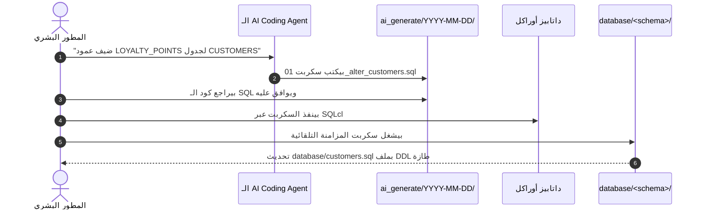

> 🇬🇧 **English Version:** Read the original article in English [here](https://ash2osh.hashnode.dev/the-cleanroom-split-why-your-code-mirror-and-ai-staging-must-never-mix).

# عزل المعمل النظيف: ليه سورس كودك، ومرايات الداتابيز، وتجارب الـ AI مستحيل يختلطوا؟ 🧼🚪

*الجزء الخامس من سلسلة "مطور APEX المدعوم بالذكاء الاصطناعي".*

* * *

## ⚡ الخلاصة في كلمتين (TL;DR)

> في أوض العمليات الجراحية، الدكاترة بيلتزموا بمناطق تعقيم صارمة جداً: الإيد اللي مش متعقمة مستحيل تلمس أدوات الجراحة، المشرط المعقم بيفضل متغطي على الصينية، والشاش المستخدم بيترمي فوراً في صندوق النفايات الطبية للمحرقة.
> 
> لما تيجي تبرمج مع وكلاء البرمجة بالذكاء الاصطناعي، أنت محتاج نفس الانضباط الفيزيائي الصارم ده بالمللي. لو رميت كل ملفات التطبيق، وملفات سحب الـ DDL، وسكربتات الـ AI الجديدة في فولدر واحد عايم، الـ Agent عاجلاً أو آجلاً هيدخل يعدل في ملفات المراية بإيده، أو يعيد كتابة سكربتات migrations قديمة، أو يرفع ملفات تجارب عشوائية على الـ Git!
> 
> بتطبيق **معمارية المعمل النظيف ذات الـ 4 مناطق**، بتبني حائط صد فيزيائي لا يمكن اختراقه بين سورس كود التطبيق الحي، ومرايات الداتابيز المخصصة للقراءة فقط، وحجرات تجارب الـ AI المعزولة للمراجعة البشرية.

* * *

## 🏥 كابوس الفولدر المفتوح على البحري (The Flat Directory)

كل مطور اشتغل مع مساعد ذكي ذاتي التوجيه في مشروع ملوش حدود فيزيائية واضحة عاش لحظة "العرق الساقع" دي:

أنت بتطلب من الوكيل الذكي (الـ Agent) الآتي:
> *"محتاجين نضيف عمود `MIDDLE_NAME` في جدول `CUSTOMERS`، ونحدث شاشة تعديل بيانات العميل."*

الـ Agent يرد بكل نشاط وحماس:
> *"كله تمام يا باشا! حدثت لك تعريفات الداتابيز بالكامل!"*

تفتح الـ Git Diff وأنت متوقع تشوف سكربت Migration جديد وشيك، فتتصدم بالمشهد العبثي:
1. **تشويه المراية (Mirror Mutation)**: الـ Agent فتح ملف `database/tables/CUSTOMERS.sql`—اللي المفروض يكون نسخة قراءة فقط جاية طازة من `DBMS_METADATA`—ودخل كتب العمود الجديد بإيده جوه الملف! الداتابيز الحقيقية محدش لمسها، بس الـ Git دلوقتي بيدعي إن الجدول اتخلق بالعمود ده من أول يوم في التاريخ!
2. **تعديل السكربتات التاريخية القديمة**: أو الأسوأ من كده: الـ Agent لقى ملف `migrations/001_initial_schema.sql` معمول من سنتين، فدخل عدل فيه وحط العمود الجديد هناك، وبوظ كل سجلات تتبع الـ Deployments!
3. **تلوث المستودع بالكراكيب**: الفولدر الرئيسي بقى ماليان ملفات تجارب عشوائية زي `test_query.sql` و `temp_output.json` وسكربتات بايثون مكسورة رماها الـ Agent وهو شغال.

ليه ده بيحصل؟ لأن **نماذج الذكاء الاصطناعي مبيفهموش الحدود غير المرئية**. لو الملف موجود في الفولدر والـ Agent معاه صلاحية كتابة، هيعتبره سورس كود يقدر يعدل فيه براحته!

عشان كده إحنا مبنعتمدش على التنبيهات الضعيفة في الـ Prompt زي *"أرجوك متعدلش في فولدر المراية"*. إحنا بنفرض **حدود فيزيائية للمعمل النظيف**.

* * *

## 🚪 معمارية المعمل النظيف ذات الـ 4 فولدرات (Cleanroom Architecture)

سواء بتدير تطبيق أبيكس صغير أو نظام مؤسسي عملاق، تقسيم المستودع لـ 4 مناطق فيزيائية مستقلة بيضمنلك الأمان والراحة التامة:

```plaintext
my-apex-project/
├── apps/<schema>/<app-id>/         ← ✏️ المنطقة 1: سورس كود شاشات أبيكس الحية (.apx)
├── database/<schema>/              ← 🪞 المنطقة 2: فاترينة المراية (للقراءة فقط من DBMS_METADATA)
├── ai_generate/YYYY-MM-DD/         ← 🚀 المنطقة 3: غرفة العزل ومطبخ السكربتات للمراجعة البشرية
└── scratch/                        ← 🗑️ المنطقة 4: سلة التجارب المؤقتة (مهملة في الـ Git)
```

تعالوا نعمل جولة سريعة جوه كل منطقة ونشوف إزاي بتحمي شغلك.

* * *

### المنطقة 1: `apps/` (ورشة العمل الحية)
ده المكان اللي بيعيش فيه سورس كود شاشات تطبيق أبيكس.
* **إيه اللي موجود هنا**: ملفات لغة APEXlang (`.apx`) المقسمة، ومكونات الـ Shared Components، والقوائم، وإعدادات التطبيق.
* **مين اللي بيعدل هنا**: أنت والـ AI بتعدلوا هنا مباشرة لما تبنوا صفحات جديدة أو تعدلوا في شاشات موجودة.
* **ليه المكان ده آمن**: لأن كل صفحة معزولة تماماً في ملفها المستقل (زي `page_00012.apx`)، فمستحيل تعديل صفحة 12 يخبط بالخطأ في صفحة 40!

* * *

### المنطقة 2: `database/` (المراية المحرمة: للعرض فقط!)
الفولدر ده هو الانعكاس الرقمي الصافي لداتابيز أوراكل الحية.
* **إيه اللي موجود هنا**: سحب كامل ونظيف لتعريفات الجداول، والـ Views، والـ Package Specs، والـ Triggers (مسحوبة عبر `DBMS_METADATA`).
* **القاعدة الحديدية**: **ممنوع نهائياً على أي إنسان أو AI إنه يعدل ملف جوه `database/` بإيده!**
* **بيتحدث إزاي**: بيتحدث *فقط وحصرياً* عبر سكربتات التصدير الآلية بعد ما الـ Migrations تتراجع وتتنفذ على الداتابيز الحقيقية.
* **حماية الحدود**: حط قاعدة في الـ Git pre-commit hooks ترفض أي تعديل يدوي في الفولدر ده.

* * *

### المنطقة 3: `ai_generate/YYYY-MM-DD/` (غرفة العزل والمراجعة)
لما الـ AI ينشئ جدول جديد، أو يكتب سكربت `ALTER TABLE`، أو يبرمج Package Body جديدة، **يحط الملفات فين؟**

ممنوع يرميها على الداتابيز مباشرة، وممنوع يقرب من فولدر المراية `database/`. بيكتبها جوه فولدر عزل مؤرخ باليوم:

```plaintext
ai_generate/2026-09-05/
├── 01_add_middle_name_to_customers.sql
├── 02_pkg_customer_api_body.sql
└── deployment_manifest.txt
```

#### ليه غرفة العزل دي فكرة عبقرية؟
1. **مراجعة بشرية مع كوباية الشاي**: تقدر تفحص كود الـ SQL سطر سطر قبل ما يتنفذ على الداتابيز.
2. **سجل تدقيق تاريخي لا يتغير**: لو بعد 3 شهور حد سأل "هو العمود ده اتضاف ليه ومين اللي عمله؟"، تلاقي السكربت والملف بتاريخه المحفوظ في الـ Git.
3. **تراجع بدون أي خساير (Effortless Rollback)**: لو جربت فكرة ومطلعتش حلوة، امسح فولدر `ai_generate/2026-09-05/` في ثانية، وكود مشروعك الأصلي يفضل نظيف 100%!

* * *

### المنطقة 4: `scratch/` (سلة التجارب المؤقتة)
كل مطور وكل AI Agent محتاج مكتب متكركب يجرب فيه تعبيرات الـ Regex، ويرمي فيه ردود JSON مؤقتة من APIs، أو يجرب سكربتات سريعة.
* **إيه اللي هنا**: ملفات تجارب عشوائية، لوجات مؤقتة، ومخرجات جراف تمهيدية.
* **حالتها في الـ Git**: **معمولها Gitignore بنسبة 100%**.
* **القاعدة الذهبية**: أي حاجة جوه `scratch/` تقدر تدلتها في أي لحظة من غير ما تقلق على مشروعك.

* * *

## 🔄 دورة حياة الميزة خطوة بخطوة

تعالوا نشوف إزاي التقسيم ده بيحول مهمة تطوير بالذكاء الاصطناعي من مخاطرة مرعبة لـ Pipeline هندسي محكم:



1. **الطلب**: طلبت من الـ AI إضافة عمود وتحديث شاشة العميل.
2. **الكتابة في غرفة العزل**: الـ Agent بيكتب السكربت في `ai_generate/2026-09-05/`.
3. **المراجعة البشرية**: أنت بتراجع الكود، وتتأكد من الـ Data Types والـ Constraints.
4. **التنفيذ**: بتنفذ السكربت على داتابيز التطوير باستخدام SQLcl وحراس الأمان.
5. **مزامنة المراية**: سكربت التصدير الآلي بيشتغل ويسحب ميتاداتا الجدول الجديد في `database/`.
6. **الـ Git Commit**: بترفع التعديل المعتمد والمراية المحدثة في كوميت واحدة نظيفة ومحترمة.

صفر كوارث. صفر تضارب في الداتابيز. وصفر تهييس من الـ AI يلمس الـ Production!

* * *

## 🛡️ إزاي تطبق المعمل النظيف في أي مشروع؟

مش محتاج أدوات مدفوعة نهائياً:
1. **أنشئ الفولدرات الأربعة**: `apps/`، و `database/`، و `ai_generate/`، و `scratch/`.
2. **ظبط ملف `.gitignore`**: ضيف `/scratch/` وأي ملفات أسرار محلية.
3. **عرف وصايا الـ Agent بوضوح**: جوه ملف القواعد (مثل `AGENTS.md` أو `.cursorrules`) كالآتي:
   * *"ممنوع تماماً تعديل أي ملف جوه `database/`."*
   * *"كل سكربتات الـ SQL والـ Migrations الجديدة تتكتب حصراً في `ai_generate/<YYYY-MM-DD>/`."*
   * *"تعديلات الشاشات تكون جوه فولدر `apps/` فقط."*

> [!TIP]
> ### 📦 عايز مشروع متظبط وجاهز بالمعمل النظيف؟
> مستودع [APEX Project Template](https://github.com/ash2osh/APEX_PROJECT_TEMPLATE) المفتوح المصدر بيجي ومعاه المعمل النظيف ده متظبط بالكامل بسكربتات المزامنة وقواعد الـ Agents. تقدر تستخدمه فوراً وتبني عليه بثقة تامة!

* * *

## 🚀 إيه اللي مستنينا في الجزء السادس؟

دلوقتي بعد ما قفلنا حدود المشروع الفيزيائية، بنقابل مشكلة تانية مشهورة جداً في الشغل مع الذكاء الاصطناعي: **زهايمر الـ LLM**.

كل ما تفتح شات جديد، الـ AI بينسى أسماء الـ Schemas، وتسمية المتغيرات، ورقم التطبيق اللي شغالين عليه!

في **الجزء السادس ("جلسة التعارف: منح الـ AI ذاكرة دائمة بفولدر app_context/")**، هنشوف إزاي ملفات السياق الموجهة وأمر التهيئة `/init` بيمحوا الزهايمر ده للأبد!

استنونا في الجزء السادس! 📓✨

* * *

*كتبه:* [*أحمد شريف (Ahmed Sherif)*](https://www.linkedin.com/in/ahmed-d-sherif)*.*
