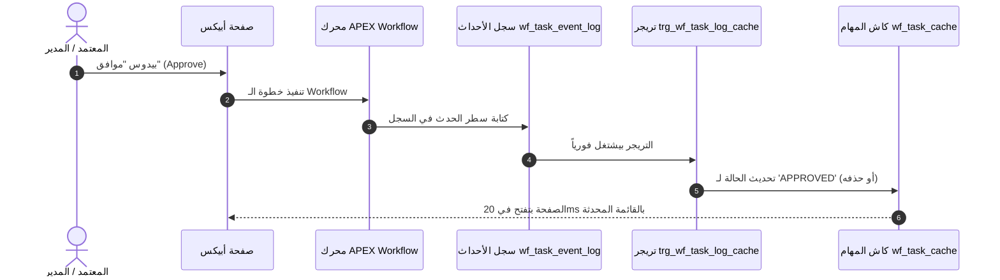

> 🇬🇧 **English Version:** Read the original article in English [here](https://ash2osh.hashnode.dev/event-driven-cache-sync-keeping-your-task-cache-100-fresh).

# تزامن الكاش بالأحداث: تحديث كاش المهام بنسبة 100% فورياً بالـ Triggers 🔄🔔

*الجزء الثالث من سلسلة "إدارة الـ Workflows الضخمة في أوراكل أبيكس".*

* * *

## ⚡ الخلاصة في كلمتين (TL;DR)

> فيه طريقتين عشان تعرف إن فنجان القهوة بتاعك جهز في كافيه زحمة الصبح: يا إما تفضل واقف قدام الباريستا وكل 15 ثانية تهتف بصوت عالي: *"القهوة بتاعتي خلصت ولا لسه؟!"* (طريقة الـ Polling)، أو إن الباريستا يرن جرس التنبيه الصغير في نفس اللحظة اللي فنجانك بينزل فيها على الرخامة (طريقة الـ Event-Driven Notification).
> 
> عشان نحافظ على تزامن جدول الكاش السريع (**`wf_task_cache`**) مع تنقلات مهام Oracle APEX، بنبعد تماماً عن وظائف الجدولة الدورية التقيلة (Scheduler Jobs). وبدل كدة، بنستخدم تريجرات داتابيز ذكية معتمدة على الأحداث، مربوطة بـ Packages محكمة لتحديث الكاش فورياً.
> 
> ده بيحقق دقة وتزامن بنسبة 100% في واجهات أبيكس مع صفر وظائف مجدولة، وصفر تأخير، وصفر قفل أو تضارب على الجداول (Lock Contention).

* * *

## ☕ فخ الـ Polling ضد نمط جرس الخدمة (Service Bell Pattern)

في معماريات الكاش، كتير من المطورين اللي مبيحبوش يوجعوا دماغهم بتزامن البيانات بيستسهلوا: يروح يعمل وظيفة `DBMS_SCHEDULER` تشتغل كل 5 دقائق عشان تعيد بناء جدول الكاش بالكامل من الصفر.

في بيئات الشركات الكبيرة والزحمة، الجدولة الدورية دي بتعمل مصيبتين كبار:

### 1. لاج "الموافقة الشبح" (Ghost Approval Lag)
مدير إدارة يفتح شاشة أبيكس، يراجع طلب شراء مهم بـ 50 ألف دولار، ويدوس **موافق (Approve)**.
الصفحة تعمل Refresh—ولأن وظيفة الكاش لسه ميعادها مجاش، الطلب يفضل ظاهر قدامه على الشاشة بحالة `PENDING`! المدير يتلخبط ويدوس **Approve** تاني، فيطلع له إيرور أو تتكرر أوامر الشراء في السيستم!

### 2. حرق الـ I/O والـ CPU على الفاضي
وظيفة شغالة كل 60 ثانية بتحرق في معالج وسيرفر الداتابيز 24 ساعة في اليوم، 7 أيام في الأسبوع—حتى الساعة 3 الفجر يوم الأحد والشركة كلها في إجازة ومفيش طلب واحد اتبعت من 8 ساعات!

بدل الـ Polling المرهق، بنستخدم **نمط جرس الخدمة (Service Bell Pattern)**:
أول ما أي إجراء بيحصل على الـ Workflow، الداتابيز بتحدث سطر الكاش في **نفس المعاملة (Database Transaction)**. ولما صفحة أبيكس تفتح في متصفح المدير، بيكون جدول الكاش اتحدث وجاهز 100%!



* * *

## 🏗️ دفتر سجل الأحداث: جدول `wf_task_event_log`

عشان نفصل العمليات بنظافة، بنسجل كل حركة بتحصل في جدول أحداث تاريخي ثابت في الـ Schema المخصصة للداتا (`app_data`) كالآتي:

```sql
-- ====================================================================
-- جدول: app_data.wf_task_event_log
-- الهدف: دفتر أستاذ تاريخي ثابت بيسجل كل حركة وانتقال في الـ Workflow
-- ====================================================================

create table app_data.wf_task_event_log (
    event_id         number generated always as identity primary key,
    request_id       number not null,
    task_id          number,
    action_type      varchar2(50)  not null, -- 'CREATE', 'APPROVE', 'REJECT', 'REASSIGN'
    previous_status  varchar2(50),
    new_status       varchar2(50)  not null, -- 'PENDING', 'APPROVED', 'REJECTED'
    action_user      varchar2(100) default coalesce(sys_context('APEX$SESSION','APP_USER'), user) not null,
    action_comments  varchar2(4000),
    event_timestamp  timestamp with local time zone default current_timestamp not null
);

create index app_data.wf_task_event_req_idx 
    on app_data.wf_task_event_log(request_id, event_timestamp desc);
```

كل تغيير في الحالة—سواء اتعمل بمحرك أبيكس التلقائي، أو بانتهاء المهلة (Timeout)، أو بضغطة زرار من موظف—بيسجل سطر في الدفتر ده.

* * *

## 🔔 التريجر الخفيف: دور الجرس فقط

تريجرات الداتابيز المفروض متكونش مليانة لوجيك بيزنس ولا استدعاءات تقيلة. التريجر الصح بيعمل حاجة واحدة بس: **بيرن الجرس ويسلم المفاتيح لـ PL/SQL Package جاهزة ومتجمعة**.

```sql
-- ====================================================================
-- تريجر: app_data.trg_wf_task_log_cache
-- ====================================================================

create or replace trigger app_data.trg_wf_task_log_cache
after insert or update on app_data.wf_task_event_log
for each row
begin
    -- تفويض فوري للـ Package المركزية لمزامنة الكاش
    app_code.pkg_task_cache.sync_task_cache(
        p_request_id => :new.request_id,
        p_task_id    => :new.task_id,
        p_action     => :new.action_type,
        p_new_status => :new.new_status,
        p_user       => :new.action_user
    );
end;
/
```

* * *

## ⚙️ منسق الكاش: Package الـ `pkg_task_cache`

تعالوا نشوف كود الـ Package اللي في سكيما البرمجة (`app_code`). لاحظ إزاي بتتعامل بذكاء مع الحالات المستمرة والحالات النهائية:

```sql
create or replace package app_code.pkg_task_cache as
    procedure sync_task_cache(
        p_request_id in number,
        p_task_id    in number,
        p_action     in varchar2,
        p_new_status in varchar2,
        p_user       in varchar2
    );
end pkg_task_cache;
/

create or replace package body app_code.pkg_task_cache as

    procedure sync_task_cache(
        p_request_id in number,
        p_task_id    in number,
        p_action     in varchar2,
        p_new_status in varchar2,
        p_user       in varchar2
    ) is
    begin
        -- السيناريو (أ): الوصول لحالة نهائية (انتهت المهمة)
        -- لما المهمة تعتمد أو تترفض أو تتلغي، مبقتش شغل نشط.
        -- بنمسحها فوراً من جدول الكاش السريع!
        if p_new_status in ('APPROVED', 'REJECTED', 'CANCELLED', 'EXPIRED') then
            delete from app_data.wf_task_cache
             where request_id = p_request_id;
             
        -- السيناريو (ب): انتقال لحالة نشطة جديدة (استلام، قيد التنفيذ، إعادة توجيه)
        else
            update app_data.wf_task_cache
               set status     = p_new_status,
                   task_id    = coalesce(p_task_id, task_id),
                   updated_at = current_timestamp
             where request_id = p_request_id;

            -- لو السطر مكنش لسه موجود في الكاش (مثلاً مهمة جديدة لسه متكريتة حالا)
            if sql%rowcount = 0 then
                insert into app_data.wf_task_cache (
                    request_id,
                    task_id,
                    task_group,
                    task_type,
                    status,
                    title,
                    priority,
                    requester_name,
                    potential_owners,
                    created_at,
                    updated_at
                )
                select r.request_id,
                       p_task_id,
                       r.request_group,
                       r.request_type,
                       p_new_status,
                       r.title,
                       r.priority,
                       r.requester_name,
                       r.potential_owners,
                       current_timestamp,
                       current_timestamp
                  from app_data.wf_requests r
                 where r.request_id = p_request_id;
            end if;
        end if;
    end sync_task_cache;

end pkg_task_cache;
/
```

* * *

## 🛡️ القواعد الذهبية التلاتة لتريجرات بدون أي بطء أو قفل جداول

عشان تضمن إن التزامن ده يشتغل مع آلاف العمليات المتزامنة في نفس اللحظة:

### 1. التعديل المستهدف لسطر واحد بمفتاح فريد (Targeted Single-Row Writes)
لاحظ إن جمل الـ UPDATE والـ DELETE بتفلتر بـ `where request_id = p_request_id`. ولأن `request_id` عليه B-Tree Index، أوراكل بتقفل بس السطر ده بالذات لأجزاء من الميلي ثانية وتسيبه فوراً.

### 2. إياك تستخدم `AUTONOMOUS_TRANSACTION` في تحديث الكاش!
بعض المطورين بيحاولوا يخلوا كود التريجر ده معزول بـ `PRAGMA AUTONOMOUS_TRANSACTION`. غلط كبير! لو المعاملة الرئيسية اتلغت (Rollback) بسبب قيد في الداتابيز، كود الكاش هيفضل محفوظ—وهتسيب مهمة "شبح" يتيمة في الكاش! وجودهم في نفس المعاملة بيضمن تكامل بيانات ACID بنسبة 100%.

### 3. الحذف الفوري للطلبات المنتهية
جدول كاش العمليات معمول عشان يشيل **الشغل الشغال بس**. أول ما المهمة تنتهي بموافقة أو رفض، طيرها من `wf_task_cache`. تاريخها المحفوظ متسجل للأبد في جدول الأحداث `wf_task_event_log`.

* * *

## 🚀 إيه اللي مستنينا في الجزء الرابع؟

الباك إند دلوقتي طيارة ومتزامن في اللحظة نفسها. بس ماذا عن تجربة المستخدم في الشاشات؟

لما المعتمد يفتح مهمة معينة، كل خطوة في الـ Workflow بتتطلب زراير مختلفة:
* خطوة 1 محتاجة زراير: *موافق*، *مرفوض*، *طلب معلومات إضافية*.
* خطوة 2 محتاجة زراير: *تأكيد الميزانية*، *رفع الفاتورة*.
* خطوة 3 محتاجة زرار: *صرف المستحقات*.

في **الجزء الرابع ("وداعاً للزراير الثابتة: تخزين أكشنز الشاشات في سطور الداتابيز")**، هنشوف إزاي تخزين إعدادات الزراير في جدول ميتاداتا بيقضي تماماً على كابوس إدارة 40 زرار بشروط معقدة جوه APEX Page Designer!

استنونا في الجزء الرابع! 🎛️📋✨

* * *

*كتبه:* [*أحمد شريف (Ahmed Sherif)*](https://www.linkedin.com/in/ahmed-d-sherif)*.*
