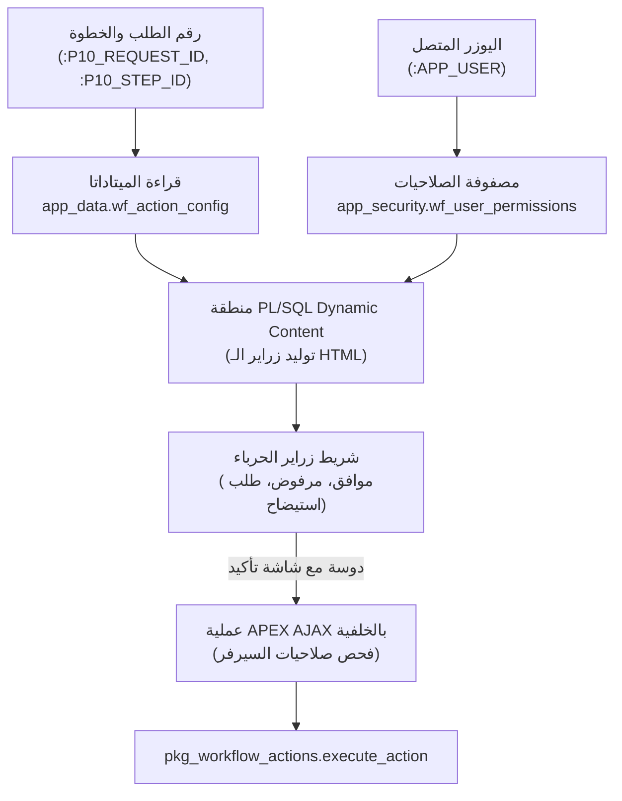

> 🇬🇧 **English Version:** Read the original article in English [here](https://ash2osh.hashnode.dev/the-chameleon-cockpit-dynamically-rendering-action-bars-in-oracle-apex).

# شاشة الحرباء: الرسم الديناميكي لأشرطة الأكشنز في Oracle APEX 🦎🎚️

*الجزء الخامس من سلسلة "إدارة الـ Workflows الضخمة في أوراكل أبيكس".*

* * *

## ⚡ الخلاصة في كلمتين (TL;DR)

> تخيل لوحة مفاتيح لخزنة إلكترونية فائقة الأمان، الأرقام والزراير فيها مبتنورش ومبتظهرش أصلاً إلا لو كارت الأمان بتاعك معاه الصلاحية إنه يدوس عليها! بالنسبة لأي شخص مش مصرح له، الزراير كأنها مش موجودة في الكون أصلاً!
> 
> في الدليل ده، هنربط جدول الميتاداتا الوصفي بتاعنا (**`wf_action_config`**) مع مصفوفة صلاحيات المستخدمين (**`wf_user_permissions`**) جوه **منطقة PL/SQL Dynamic Content واحدة** على صفحة تفاصيل الطلب في أبيكس.
> 
> ده بيحول صفحة أبيكس يتيمة لواجهة "حرباء (Chameleon)" متعددة الأشكال، بتغير زرايرها وألوانها وأيقوناتها ورسائل التأكيد المنبثقة لكل خطوة workflow—ومدعومة بحماية سيرفر صارمة لا يمكن اختراقها.

* * *

## 🦎 تأثير الحرباء: صفحة واحدة تدير المنظومة كلها

في المعماريات البدائية لأوراكل أبيكس، كتير من المطورين بيعملوا صفحة تفاصيل مستقلة لكل نوع طلب:
* صفحة 10 لأوامر الشراء (Purchase Orders)
* صفحة 11 للمصروفات الرأسمالية (CAPEX)
* صفحة 12 لفواتير الموردين (Vendor Invoices)
* صفحة 13 لطلبات العهد والأجهزة

الطريقة دي بتتحول بسرعة لكابوس صيانة مرعب:
* لو الفريق حب يحدث التصميم العام، أو شريط التنقل (Breadcrumbs)، أو شاشة سجل الحركات، مضطر يكرر التعديل يدوياً في 4 صفحات مختلفة!
* لو عندك 30 مسار عمل في الشركة، صيانة 30 صفحة مختلفة بتبقى جحيم هندسي.

في المعمارية الاحترافية للشركات، بنستخدم **صفحة تفاصيل واحدة فقط** بتتصرف زي الحرباء بالظبط!

أول ما بتفتح، الصفحة بتبص على رقم الطلب ورقم الخطوة، وتقرا الميتاداتا من الداتابيز، وتفحص صلاحيات اليوزر المسجل، وفي غمضة عين بتغير شريط الأكشنز بتاعها عشان تعرض بس الزراير المسموح له بيها!



* * *

## 💻 محرك الرسم: منطقة PL/SQL Dynamic Content

على صفحة تفاصيل الطلب (مثلاً صفحة 10)، بنعمل Region من نوع **PL/SQL Dynamic Content**:

```sql
declare
    v_step_cfg   app_data.wf_action_config%rowtype;
    v_can_btn1   varchar2(1) := 'N';
    v_can_btn2   varchar2(1) := 'N';
    v_can_btn3   varchar2(1) := 'N';
    v_can_btn4   varchar2(1) := 'N';
    v_tokens     apex_t_varchar2;
    
    procedure render_button(
        p_enabled      in varchar2,
        p_authorized   in varchar2,
        p_config_str   in varchar2,
        p_action_code  in varchar2,
        p_slot_num     in number
    ) is
        v_parts apex_t_varchar2;
    begin
        if p_enabled = 'Y' and p_authorized = 'Y' and p_config_str is not null then
            v_parts := apex_string.split(p_config_str, ',');
            -- v_parts(1) = النص، (2) = كلاس اللون، (3) = الأيقونة، (4) = فلاج التأكيد
            sys.htp.p(apex_string.format(
                '<button type="button" class="t-Button %s" ' ||
                'onclick="handleWorkflowAction(%s, ''%s'', %s)">' ||
                '<span class="t-Icon fa %s" aria-hidden="true"></span>' ||
                '<span class="t-Button-label">%s</span>' ||
                '</button>',
                v_parts(2),       -- مثلاً: 'u-success' أو 'u-danger'
                p_slot_num,       -- رقم الزرار (1..4)
                p_action_code,    -- كود الأكشن: 'APPROVE'
                v_parts(4),       -- 1 (محتاج تأكيد) أو 0 (فوري)
                v_parts(3),       -- مثلاً: 'fa-check'
                apex_escape.html(v_parts(1)) -- مثلاً: 'Approve Order'
            ));
        end if;
    end render_button;

begin
    -- 1. قراءة إعدادات أكشنز الخطوة الحالية
    select * into v_step_cfg
      from app_data.wf_action_config
     where step_id = :P10_CURRENT_STEP_ID;

    -- 2. التحقق من مصفوفة صلاحيات اليوزر المتصل
    select coalesce(max(can_action1), 'N'),
           coalesce(max(can_action2), 'N'),
           coalesce(max(can_action3), 'N'),
           coalesce(max(can_action4), 'N')
      into v_can_btn1, v_can_btn2, v_can_btn3, v_can_btn4
      from app_security.wf_user_permissions
     where step_id   = :P10_CURRENT_STEP_ID
       and user_name = :APP_USER;

    -- 3. رسم حاوية زراير الـ HTML
    sys.htp.p('<div class="t-ButtonRegion-wrap"><div class="t-ButtonRegion-col t-ButtonRegion-col--right">');

    -- رسم الزراير الأربعة حسب الصلاحية والإعدادات
    render_button(v_step_cfg.has_btn1, v_can_btn1, v_step_cfg.btn1_config, v_step_cfg.btn1_action_code, 1);
    render_button(v_step_cfg.has_btn2, v_can_btn2, v_step_cfg.btn2_config, v_step_cfg.btn2_action_code, 2);
    render_button(v_step_cfg.has_btn3, v_can_btn3, v_step_cfg.btn3_config, v_step_cfg.btn3_action_code, 3);
    render_button(v_step_cfg.has_btn4, v_can_btn4, v_step_cfg.btn4_config, v_step_cfg.btn4_action_code, 4);

    sys.htp.p('</div></div>');

exception
    when no_data_found then
        sys.htp.p('<span class="u-warning-text">لا توجد إجراءات متاحة لهذه المرحلة من الطلب.</span>');
end;
```

* * *

## 🖱️ معالج الجافاسكريبت: شاشات تأكيد أنيقة وسلسة

لاحظ إن الزراير اللي اترسمت بتنادي دالة اسمها `handleWorkflowAction(...)`. بنضيف الدالة دي في إعدادات الجافاسكريبت بالصفحة:

```javascript
function handleWorkflowAction(slotNumber, actionCode, requiresConfirm) {
    const doSubmit = function() {
        apex.server.process(
            "EXECUTE_WORKFLOW_ACTION",
            {
                x01: actionCode,
                pageItems: "#P10_REQUEST_ID,#P10_CURRENT_STEP_ID,#P10_ACTION_COMMENTS"
            },
            {
                success: function(data) {
                    if (data.status === "SUCCESS") {
                        apex.message.showPageSuccess(data.message || "تم تنفيذ الإجراء بنجاح.");
                        apex.navigation.redirect(data.redirect_url || "f?p=" + apex.env.APP_ID + ":100:" + apex.env.APP_SESSION);
                    } else {
                        apex.message.clearErrors();
                        apex.message.showErrors([{
                            type: "error",
                            location: "page",
                            message: data.message || "فشل تنفيذ الإجراء."
                        }]);
                    }
                }
            }
        );
    };

    if (requiresConfirm === 1) {
        apex.message.confirm(
            "هل أنت متأكد من رغبتك في اتخاذ هذا الإجراء؟",
            function(okPressed) {
                if (okPressed) {
                    doSubmit();
                }
            }
        );
    } else {
        doSubmit();
    }
}
```

* * *

## 🔒 أمان دفاعي متعدد الطبقات: إياك تثق في متصفح العميل!

قاعدة أمنية ذهبية في هندسة البرمجيات: **إخفاء الزرار عن الشاشة لا يعتبر أماناً!**

مجرد إن الزرار مش مرسوم في صفحة المتصفح، ده ميمنعش مستخدم خبيث أو فضولي إنه يفتح الـ Browser Console ويجرب ينادي `apex.server.process("EXECUTE_WORKFLOW_ACTION")` بإيده!

عشان نقفل الباب ده بالضبة والمفتاح، عملية الـ AJAX في السيرفر بتفوض التنفيذ لـ Package الباك إند (`app_code.pkg_workflow_actions.execute_action`) واللي بتفرض **3 فحوصات سيرفر إلزامية**:

1. **فحص الصلاحيات الصريح**: بتسأل جدول `wf_user_permissions` بشكل مستقل للتأكد إن `:APP_USER` معاه تصريح صريح للأكشن ده في الخطوة دي بالتحديد.
2. **فحص التزامن وحالة الطلب**: بتتأكد إن الطلب لسه في حالته المتوقعة، ومفيش مدير تاني سبقه واعتمد أو رفض الطلب قبله بلحظات.
3. **تسجيل الحركة في سجل الأحداث**: لو الفحوصات نجحت، بتسجل الحركة في `wf_task_event_log` وتنقل حالة الـ Workflow.

لو أي فحص فشل، السيرفر بيرمي خطأ غير معالج ويلغي المعاملة فوراً، واليوزر يستلم رسالة خطأ أمنية واضحة.

* * *

## 🚀 إيه اللي مستنينا في الجزء السادس؟

مراجعة كل طلب لوحده في شاشة الحرباء دي حاجة شيك جداً للقرارات الكبيرة زي المصروفات الرأسمالية والصفقات الضخمة.

لكن مدراء الإدارات غالباً بيدخلوا صباح يوم الإثنين يلاقوا **50 طلب روتيني متراكم** في صندوق الوارد. فكرة إنه يفتح 50 صفحة ورا بعض، ويدوس موافق 50 مرة، ويأكد 50 شاشة منبثقة دي وصفة مؤكدة للإرهاق وتطفيش المستخدمين!

في **الجزء السادس ("الختم السريع: الاعتماد الجماعي بضغطة واحدة جوه الـ Interactive Grid")**، هنبني محرك موافقات جماعية عالي السرعة مزود بحماية الـ Savepoints لعزل الأخطاء وحماية القفل التفاؤلي (Optimistic Locking)!

استنونا في الجزء السادس! 📑🖊️✨

* * *

*كتبه:* [*أحمد شريف (Ahmed Sherif)*](https://www.linkedin.com/in/ahmed-d-sherif)*.*
